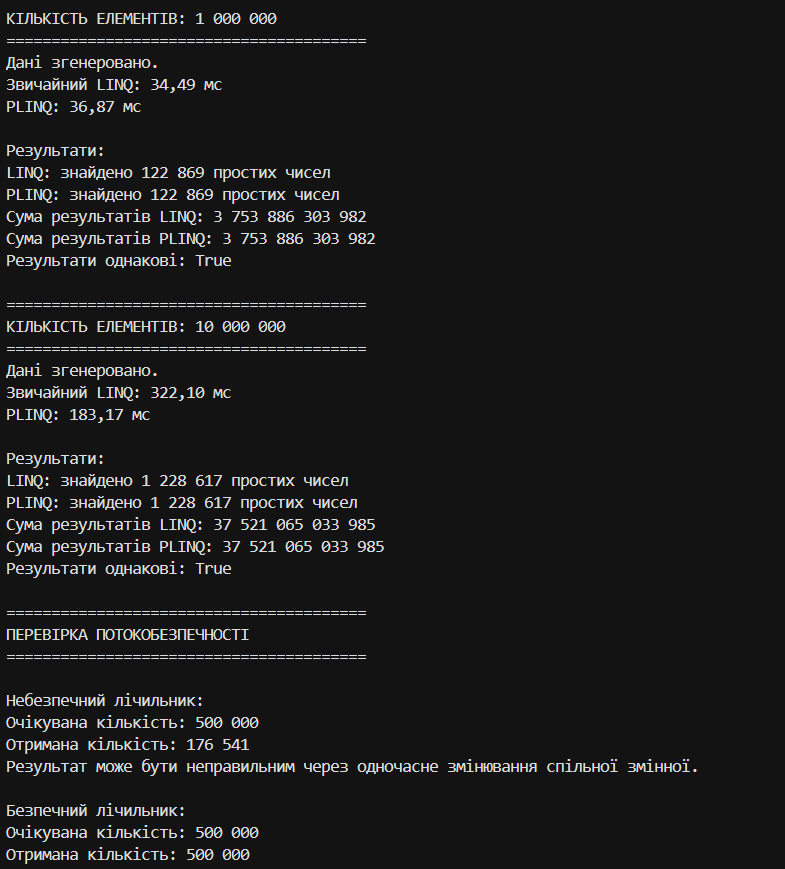

# Самостійна робота №18

## Тема
PLINQ: дослідження продуктивності та безпеки.

## Мета
Дослідити переваги та недоліки PLINQ у порівнянні зі звичайним LINQ, виміряти продуктивність на різних обсягах даних та перевірити проблеми потокобезпечності.

## Опис проєкту

Програма генерує випадкові числа та перевіряє їх на простоту. Для обробки даних використовуються звичайний LINQ і паралельний PLINQ.

## Тестові дані

Проводяться два експерименти:

- 1 000 000 елементів;
- 10 000 000 елементів.

Для генерації використовується Random із фіксованим Seed.

## Реалізовані операції

1. Генерація випадкових чисел.
2. Перевірка чисел на простоту.
3. Обчислення квадратів простих чисел.
4. Порівняння LINQ та PLINQ.
5. Вимірювання часу за допомогою Stopwatch.
6. Демонстрація проблеми потокобезпечності.
7. Виправлення проблеми за допомогою Interlocked.

## Використані технології

- C#
- .NET
- LINQ
- PLINQ
- Stopwatch
- Interlocked

## Запуск програми

```powershell
dotnet run

```

## Висновок

Під час виконання роботи я навчилася використовувати PLINQ для паралельної обробки даних, порівнювати його продуктивність зі звичайним LINQ та виправляти проблеми потокобезпечності.
