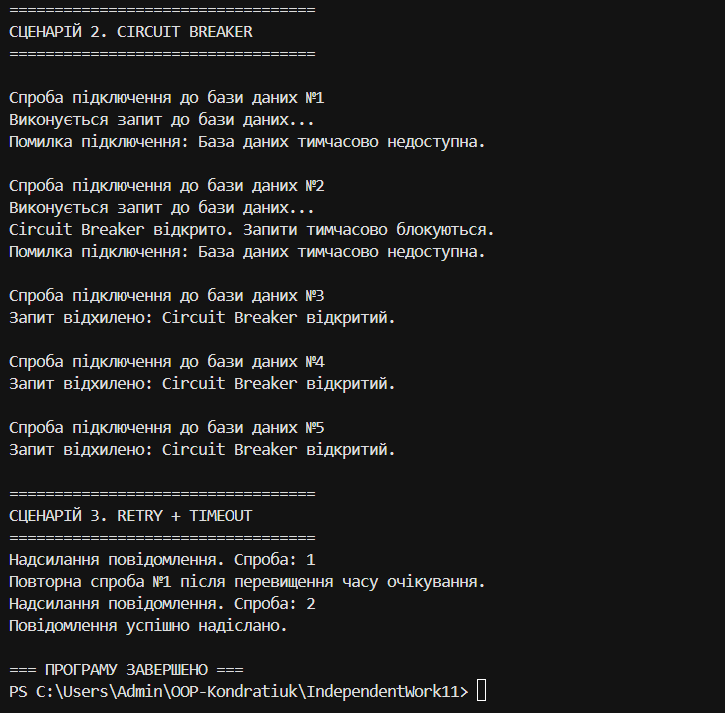

# Самостійна робота №19

## Тема
Дизайн винятків і політики retry: теорія та кейси Polly.

## Мета
Вивчити обробку винятків у C#, власні типи винятків та механізми відмовостійкості. Дослідити бібліотеку Polly та її стратегії.

## Структура проєкту

- `Program.cs` — демонстрація винятків і сценаріїв Polly.
- `InsufficientFundsException.cs` — власний тип винятку.
- `BankAccount.cs` — клас банківського рахунку.

## Реалізовані сценарії

1. **Retry** — повторне виконання запиту до зовнішнього API після тимчасової помилки.
2. **Circuit Breaker** — блокування запитів до недоступної бази даних після декількох невдалих спроб.
3. **Retry + Timeout** — повторне надсилання повідомлення, якщо операція перевищує допустимий час.

## Власний тип винятку

Створено `InsufficientFundsException`, який містить додаткові властивості:

- `RequestedAmount` — запитана сума.
- `CurrentBalance` — поточний баланс.

## Використані технології

- C#
- .NET
- Polly
- ResiliencePipelineBuilder
- Retry
- Circuit Breaker
- Timeout
- try-catch-finally

## Запуск програми

```powershell
dotnet run

```

## Висновок

Під час роботи я навчилася створювати власні типи винятків, використовувати механізм try-catch-finally та застосовувати стратегії відмовостійкості Polly для обробки тимчасових помилок.