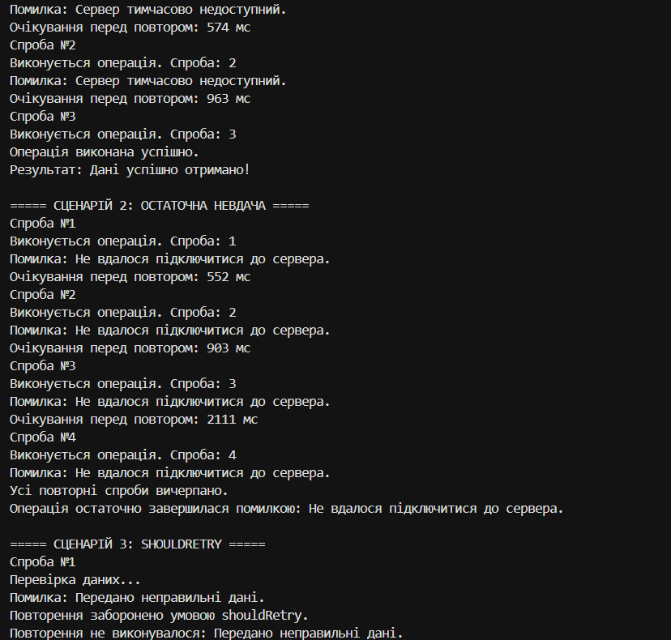

# Самостійна робота №20
## Реалізація exponential backoff

**Дисципліна:** Об'єктно-орієнтоване програмування  
**Група:** ІПЗ-3/1  
**Проєкт:** IndependentWork12

## Мета роботи

Розробити власний допоміжний клас RetryPolicy для реалізації патерну Retry з експоненційною затримкою та випадковим jitter.

## Опис програми

У програмі створено узагальнений клас `RetryPolicy`, який виконує операцію повторно, якщо вона завершується помилкою.

Клас містить:
- `_maxRetries` — максимальну кількість повторних спроб;
- `_initialDelay` — початкову затримку;
- `_jitterFactor` — коефіцієнт випадкової затримки;
- `Execute<T>` — узагальнений метод виконання операції;
- `shouldRetry` — умову, яка визначає, чи потрібно повторювати операцію.

## Реалізовані сценарії

1. Успішне виконання після двох невдалих спроб.
2. Постійна помилка та вичерпання всіх повторних спроб.
3. Заборона повторення за допомогою `shouldRetry`.

## Експоненційна затримка

Для розрахунку затримки використовується формула:

`delay = initialDelay * Math.Pow(2, retryAttempt) * (1 + random.NextDouble() * jitterFactor * 2 - jitterFactor)`

Jitter додає випадкове відхилення до затримки.

## Запуск програми

```powershell
dotnet run
