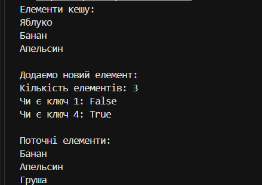

# Самостійна робота №13

## Тема
Узагальнений кеш Cache<TKey, TValue> із тестами.

## Мета
Розробити узагальнений клас кешу з обмеженою ємністю та політикою видалення найстаріших елементів FIFO. Написати юніт-тести для перевірки його роботи.

## Реалізація
Створено два проєкти:
- IndependentWork7 — основна програма.
- IndependentWork7.Tests — проєкт юніт-тестів.

У класі Cache<TKey, TValue> реалізовано:
- Додавання елементів.
- Отримання значень за ключем.
- Перевірку наявності ключа.
- Підрахунок кількості елементів.
- Видалення найстарішого елемента при переповненні кешу.

Для реалізації використано Dictionary<TKey, TValue> та Queue<TKey>.

## Тестування
Написано 7 юніт-тестів для перевірки основних методів та FIFO-поведінки кешу.

Для запуску тестів використовується команда:

dotnet test IndependentWork7.sln

## Висновок
Під час виконання самостійної роботи я навчилася створювати узагальнені класи, працювати зі словниками та чергами, реалізовувати політику FIFO і писати юніт-тести за допомогою xUnit.
