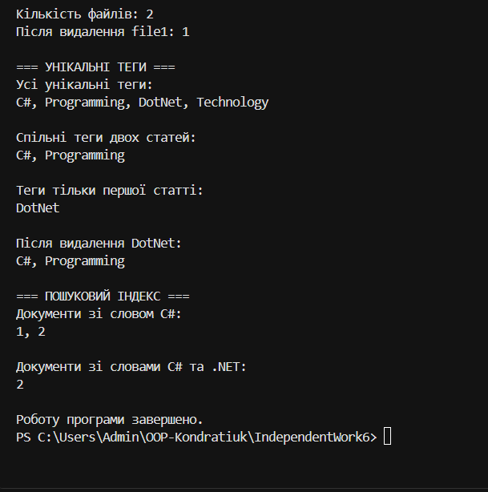

# Самостійна робота №14

## Тема
Вивчення Dictionary<TKey, TValue> та HashSet<T> у бібліотеках .NET.

## Мета
Дослідити використання узагальнених колекцій Dictionary та HashSet і навчитися застосовувати їх для вирішення практичних задач.

## Реалізовані сценарії

### 1. FileMetadataCache
Кеш метаданих файлів на основі Dictionary.
Реалізовано:
- Add — додавання файлу.
- Get — отримання метаданих.
- Remove — видалення файлу.
- Contains — перевірка наявності файлу.

### 2. TagManager
Система унікальних тегів для статей блогу на основі Dictionary та HashSet.

Реалізовано:
- Додавання та видалення тегів.
- Отримання всіх унікальних тегів.
- Пошук спільних тегів.
- Пошук тегів, які є тільки в одній статті.

Використано UnionWith, IntersectWith та ExceptWith.

### 3. SearchIndex
Пошуковий індекс на основі Dictionary<string, HashSet<int>>.

Реалізовано:
- Додавання документів.
- Пошук документів за словом.
- Пошук документів, які містять усі задані слова.

## Приклад запуску

```text
=== КЕШ МЕТАДАНИХ ФАЙЛІВ ===
Назва: document.txt
Чи існує file2: True
Кількість файлів: 2
Після видалення file1: 1

=== УНІКАЛЬНІ ТЕГИ ===
Усі унікальні теги:
C#, Programming, DotNet, Technology

Спільні теги двох статей:
C#, Programming

Теги тільки першої статті:
DotNet

Після видалення DotNet:
C#, Programming

=== ПОШУКОВИЙ ІНДЕКС ===
Документи зі словом C#:
1, 2

Документи зі словами C# та .NET:
2

Роботу програми завершено.
```

## Запуск

```powershell
dotnet run

```

## Висновок
Під час виконання роботи я навчилася використовувати Dictionary та HashSet для зберігання, пошуку й обробки даних. Реалізувала кеш метаданих, систему тегів та пошуковий індекс.
