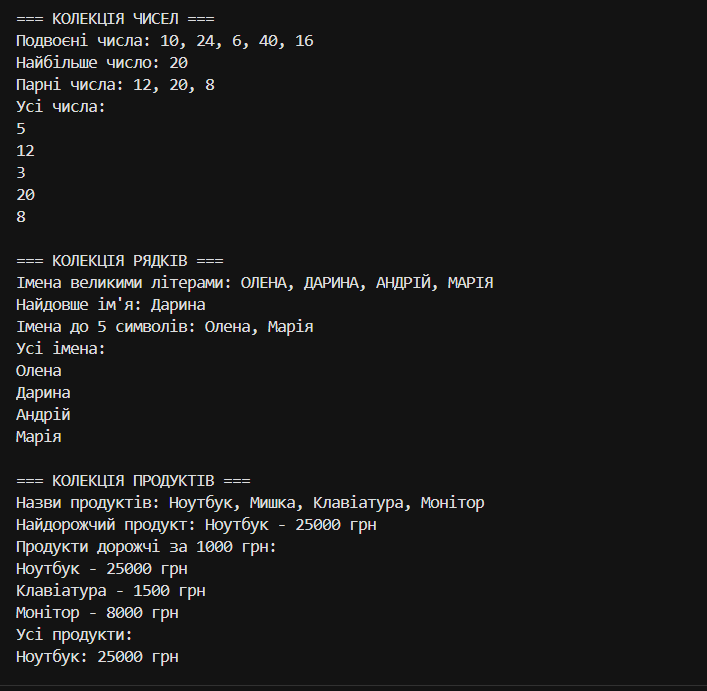

# Самостійна робота №15

## Тема
Делегати й лямбда-вирази: власні утиліти для колекцій.

## Мета
Навчитися створювати власні узагальнені методи для роботи з колекціями та використовувати делегати й лямбда-вирази.

## Реалізовані методи

- Map — перетворює кожен елемент колекції.
- MaxBy — знаходить елемент із найбільшим значенням ключа.
- Filter — відбирає елементи за умовою.
- ForEach — виконує дію для кожного елемента.

## Демонстрація

Використано три колекції:
1. List<int> — числа.
2. List<string> — імена.
3. List<Product> — продукти.

Для кожної колекції перевірено всі чотири методи.

## Запуск програми

```bash
dotnet run
```

## Висновок

Під час виконання самостійної роботи я навчилася створювати власні узагальнені методи для роботи з колекціями, використовувати делегати та лямбда-вирази.
