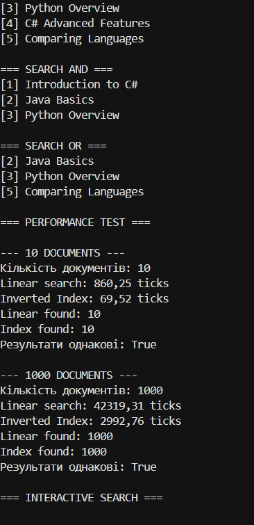

# Самостійна робота №16

## Тема
Колекції в практиці ООП: інвертований індекс і вимірювання продуктивності.

## Мета
Розробити власну реалізацію інвертованого індексу для пошуку документів за ключовими словами та порівняти швидкість пошуку.

## Реалізовані класи

- `Document` — зберігає інформацію про документ.
- `TextProcessor` — розбиває текст на слова та видаляє стоп-слова.
- `InvertedIndex` — зберігає інвертований індекс і виконує пошук.
- `PerformanceTest` — порівнює швидкість лінійного пошуку та індексу.

## Реалізовані методи пошуку

- `SearchSingleWord` — пошук за одним словом.
- `SearchMultipleWords` — пошук документів, які містять усі слова (AND).
- `SearchAnyWord` — пошук документів, які містять хоча б одне слово (OR).

## Вимірювання продуктивності

Програма автоматично створює набори з 10 та 1000 документів і порівнює два способи пошуку:

1. Лінійний пошук без індексу.
2. Пошук через Inverted Index.

Кожен пошук повторюється 1000 разів. Час вимірюється за допомогою `Stopwatch`.

## Приклад роботи

```text
=== INVERTED INDEX ===
Loaded 5 documents

=== SEARCH BY ONE WORD ===
[1] Introduction to C#
[2] Java Basics
[3] Python Overview
[4] C# Advanced Features
[5] Comparing Languages

=== SEARCH AND ===
[1] Introduction to C#
[2] Java Basics
[3] Python Overview
[4] C# Advanced Features
[5] Comparing Languages

=== SEARCH OR ===
[2] Java Basics
[3] Python Overview
[5] Comparing Languages
```

Час виконання пошуку залежить від комп'ютера, тому результати вимірювання можуть відрізнятися.

## Запуск програми

```bash
dotnet run
```

## Висновок

Під час виконання самостійної роботи я навчилася створювати інвертований індекс на основі Dictionary та HashSet, реалізовувати пошук за одним і кількома словами та вимірювати продуктивність різних способів пошуку.
```

## 9. REPORT.md

Створи `REPORT.md`:

<CodeBlock language="markdown" editable>
# Звіт
## Самостійна робота №16

**Тема:** Колекції в практиці ООП: інвертований індекс і вимірювання продуктивності.

### 1. Реалізація інвертованого індексу

Для виконання роботи я створила клас InvertedIndex, який використовує дві колекції:

- `Dictionary<string, HashSet<int>>` — зберігає слова та ID документів, у яких вони зустрічаються.
- `Dictionary<int, Document>` — зберігає документи за їхніми ID.

Також реалізовано клас TextProcessor для обробки тексту: переведення до нижнього регістру, видалення пунктуації та стоп-слів.

### 2. Реалізовані методи пошуку

- `SearchSingleWord` — знаходить документи за одним словом.
- `SearchMultipleWords` — знаходить документи, які містять усі задані слова. Для цього використовується `IntersectWith`.
- `SearchAnyWord` — знаходить документи, які містять хоча б одне задане слово. Для цього використовується `UnionWith`.

### 3. Вимірювання продуктивності

Для порівняння було реалізовано два способи пошуку:

1. Лінійний пошук — послідовна перевірка тексту кожного документа.
2. Inverted Index — пошук документів через словник та множини ID.

Для обох способів використовується однакова обробка тексту. Кожен пошук повторюється 1000 разів. Побудова індексу не враховується у часі пошуку.

Результати вимірювань:

| Кількість документів | Лінійний пошук (ticks) | Inverted Index (ticks) |
|---|---|---|
| 10 | Вставити результат із консолі | Вставити результат із консолі |
| 1000 | Вставити результат із консолі | Вставити результат із консолі |

Час залежить від характеристик комп'ютера, тому значення потрібно записати після запуску програми.

### 4. Відповіді на контрольні запитання

**1. Чому структура Dictionary<string, HashSet<int>> добре підходить для реалізації інвертованого індексу?**

Dictionary дозволяє швидко знаходити потрібне слово, а HashSet зберігає ID документів без повторень. Це зручно для пошуку документів за словами.

**2. Які переваги HashSet<T> дає під час обчислення AND/OR-пошуку за кількома словами?**

HashSet дозволяє швидко знаходити спільні елементи за допомогою IntersectWith та об'єднувати множини за допомогою UnionWith. Також він не допускає повторення ID документів.

**3. Чому під час вимірювання продуктивності важливо однаково нормалізувати текст для лінійного пошуку та пошуку через індекс?**

Тому що обидва способи повинні шукати однакові слова за однаковими правилами. Якщо нормалізація відрізняється, результати можуть бути неправильними, а порівняння швидкості — некоректним.

**4. Які обмеження має проста реалізація інвертованого індексу без ранжування, стемінгу та підтримки фраз?**

Така реалізація не визначає, який документ найкраще відповідає запиту, не розпізнає різні форми одного слова та не шукає точні фрази. Вона знаходить документи лише за окремими словами.

### 5. Висновок

Під час виконання самостійної роботи я навчилася створювати інвертований індекс за допомогою Dictionary та HashSet. Реалізувала пошук за одним словом, AND та OR, а також порівняла лінійний пошук із пошуком через індекс. Зрозуміла, що інвертований індекс особливо корисний для пошуку у великих наборах документів, хоча його побудова потребує додаткового часу та пам'яті.
