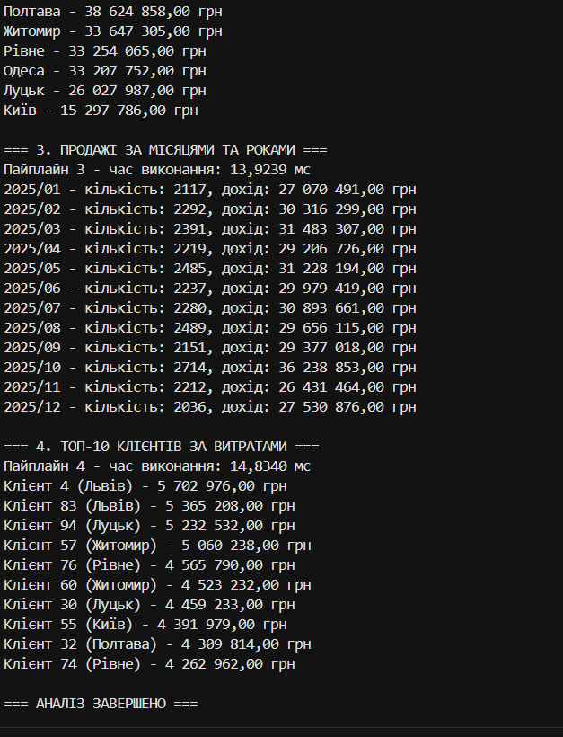

# Самостійна робота №17

## Тема
LINQ pipelines: ETL та аналітика.

## Мета
Навчитися створювати складні LINQ-пайплайни для обробки та аналізу даних, використовуючи групування, об'єднання, фільтрацію та сортування.

## Структура проєкту

- `Sale.cs` — клас продажу.
- `Product.cs` — клас продукту.
- `Customer.cs` — клас клієнта.
- `DataGenerator.cs` — генерація тестових даних.
- `Program.cs` — реалізація аналітичних LINQ-пайплайнів.

## Тестові дані

Програма створює:

- 100 продуктів;
- 100 клієнтів;
- 5000 продажів.

Для генерації використовується Random із фіксованим Seed.

## Реалізовані LINQ-пайплайни

1. Найпопулярніші продукти за категоріями.
2. Загальний дохід за містами клієнтів.
3. Продажі за місяцями та роками.
4. Топ-10 клієнтів за витратами.

## Вимірювання продуктивності

Для кожного пайплайна використовується Stopwatch. Час виконання виводиться в мілісекундах.

## Використані оператори LINQ

- `GroupBy` — групування даних.
- `Join` — об'єднання колекцій.
- `Select` — формування результатів.
- `Sum` — обчислення сум.
- `OrderBy` — сортування за зростанням.
- `OrderByDescending` — сортування за спаданням.
- `Take` — отримання перших елементів.

## Запуск програми

```bash
dotnet run
```

## Висновок

Під час виконання самостійної роботи я навчилася створювати LINQ-пайплайни для аналізу продажів, використовувати групування та об'єднання колекцій, а також вимірювати продуктивність запитів.
