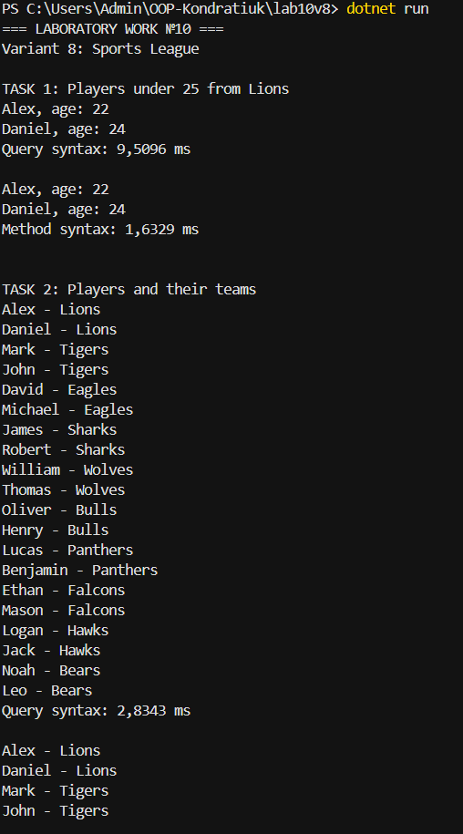

# Лабораторна робота №10

**Тема:** LINQ в дії: фільтри, join, агрегації.  
**Варіант:** 8 — Спортивна ліга.

## Опис
Консольний проєкт на C#, який працює з командами та гравцями.

Реалізовано:
- Пошук гравців до 25 років із команди Lions.
- Об'єднання гравців із командами.
- Обчислення середнього віку гравців.
- Пошук найстаршого гравця.
- Вимірювання часу виконання LINQ-запитів через Stopwatch.

