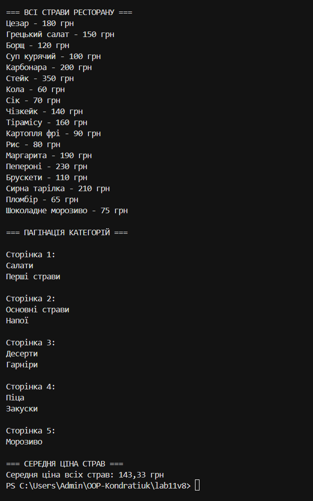

# Лабораторна робота №11

**Тема:** LINQ: SelectMany, пагінація й custom extensions.

## Виконано
- Створено класи `RestaurantMenu`, `DishCategory`, `Dish`.
- Реалізовано `SelectMany` для отримання всіх страв.
- Реалізовано пагінацію категорій за допомогою `Skip()` і `Take()`.
- Створено метод розширення `AverageDishPrice()` для обчислення середньої ціни страв.

