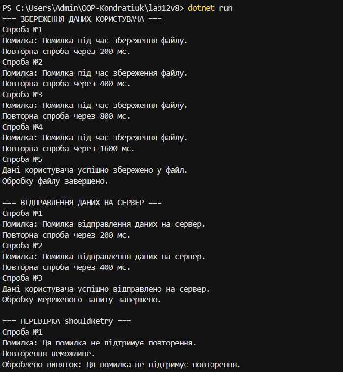

# Лабораторна робота №12

**Тема:** Обробка IO/мережевих помилок та патерн Retry.

## Мета роботи
Навчитися обробляти помилки під час роботи з файлами та мережею, а також використовувати патерн Retry для повторного виконання операцій.

## Виконано
- Створено клас `FileProcessor` для збереження даних у файл.
- Створено клас `NetworkClient` для імітації відправлення даних на сервер.
- Реалізовано універсальний метод `ExecuteWithRetry<T>()`.
- Додано перевірку помилок через `shouldRetry`.
- Реалізовано експоненційну затримку між повторними спробами.
- Використано конструкції `try-catch-finally`.

