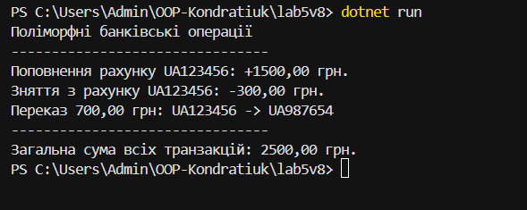

# Лабораторна робота №5

**Тема:** Поліморфізм: динамічне зв’язування та перевизначення методів

**Дисципліна:** Об’єктно-орієнтоване програмування  
**Група:** ІПЗ-3/1  
**Студент:** Кондратюк Дарина  
**Варіант:** 8

## Мета роботи

Навчитися реалізовувати поліморфізм у C# за допомогою віртуальних методів `virtual` та їх перевизначення `override`, а також працювати з колекціями базового типу.

## Реалізована ієрархія

- `Transaction` — базовий клас;
- `Deposit` — поповнення рахунку;
- `Withdrawal` — зняття коштів;
- `Transfer` — переказ коштів.

У кожному похідному класі перевизначено метод `Execute()`.

## Поліморфізм

У програмі використовується колекція `List<Transaction>`, яка містить об’єкти різних похідних класів. Під час виклику `Execute()` автоматично виконується відповідна реалізація методу для кожного об’єкта.

## Агрегація

Програма обчислює загальну суму всіх транзакцій.

**Результат: 2500 грн.**

## Результат роботи

## Висновок

Під час виконання лабораторної роботи я навчилася використовувати поліморфізм, віртуальні методи та їх перевизначення в C#. Я реалізувала ієрархію банківських операцій, використала колекцію базового типу та виконала агрегацію результатів.