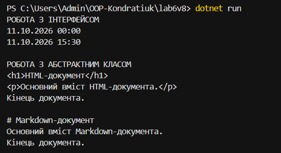

# Лабораторна робота №6

**Тема:** Абстрактні класи та інтерфейси. Контракти та реалізації.

**Варіант 8:** IParser та Renderer.

**Мета:** Навчитися використовувати інтерфейси й абстрактні класи для реалізації поліморфізму.

**Виконання роботи**

Створено інтерфейс `IParser<T>` та класи `DateParser` і `TimeParser`, які реалізують парсинг дати й часу.

Створено абстрактний клас `Renderer` із методами відображення заголовка, основного вмісту та завершення документа. Реалізовано класи `HtmlRenderer` і `MarkdownRenderer`.

У методі `Main` продемонстровано поліморфні виклики через колекції інтерфейсу та абстрактного класу.

**Висновок**

Я навчилася створювати інтерфейси й абстрактні класи, реалізовувати їх у похідних класах та використовувати поліморфізм у C#.

