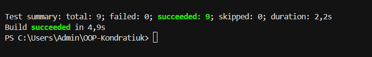

# Лабораторна робота №7

**Тема:** Узагальнені типи (Generics). IRepository з where-обмеженнями та тестами.

**Варіант:** 8  
**Сутність:** TaskItem

## Мета роботи

Навчитися створювати узагальнені інтерфейси, використовувати where-обмеження та писати юніт-тести.

## Структура проєкту

- `lab12v8` — основний проєкт.
- `lab12v8.Tests` — проєкт тестування.

## Реалізація

- `IEntity` визначає властивість `Id`.
- `IRepository<T>` описує CRUD-операції та використовує обмеження `where T : IEntity`.
- `InMemoryRepository<T>` реалізує зберігання й обробку об'єктів у списку.
- `TaskItem` містить властивості `Id`, `Title`, `Description` та `IsCompleted`.
- `RepositoryTests` перевіряє додавання, отримання, оновлення та видалення елементів, включно з обробкою неіснуючих ID.

## Висновок

Я навчилася використовувати узагальнені типи, створювати інтерфейси та реалізовувати CRUD-операції. Також я написала юніт-тести для перевірки правильності роботи репозиторію.
