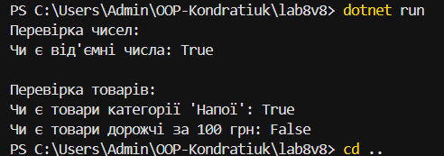

# Лабораторна робота №8 — Варіант 8

**Тема:** Делегати й лямбда-вирази.  
**Мета:** Навчитися працювати з делегатами та колекціями.

**Завдання:** Реалізувати узагальнений клас `CollectionHelper<T>` з методом `Any`, який перевіряє, чи є хоча б один елемент, що відповідає заданій умові.

**Реалізація:** Використано `Predicate<T>`, лямбда-вирази та цикл `foreach`.

**Перевірка:** Метод протестовано на `List<int>` та `List<Product>`.

**Результат:** Програма працює правильно.

**Технології:** C#, .NET SDK.
