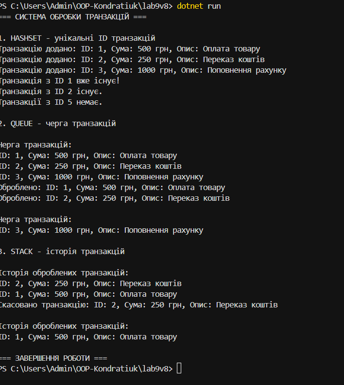

# Лабораторна робота №9

**Тема:** HashSet/Queue/Stack: практичні сценарії.

**Варіант №8 — Обробка транзакцій.**

### Мета роботи
Навчитися використовувати колекції HashSet, Queue та Stack для обробки транзакцій.

### Реалізація

- **HashSet<int>** — зберігає унікальні ID транзакцій та перевіряє наявність повторів.
- **Queue<Transaction>** — зберігає транзакції в черзі та обробляє їх у порядку додавання.
- **Stack<Transaction>** — зберігає історію оброблених транзакцій та дозволяє скасувати останню операцію.

### Результат
Створено консольну програму для обробки транзакцій. Реалізовано додавання, перевірку унікальності, обробку та скасування транзакцій.

Програму успішно зібрано та запущено.
